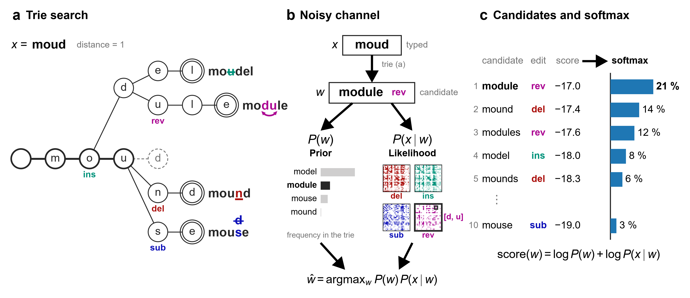
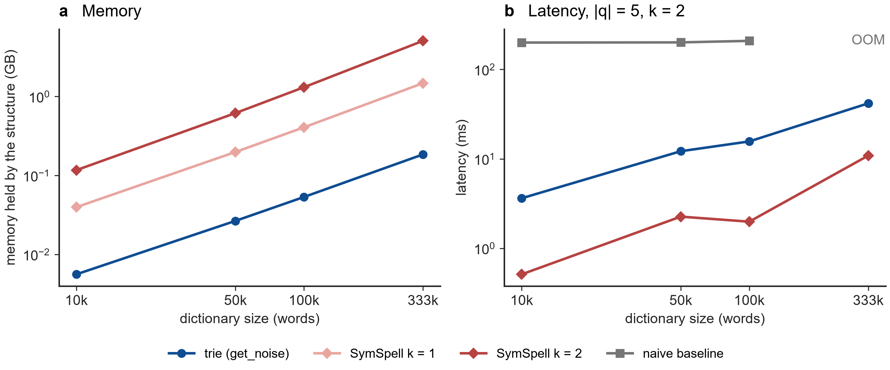
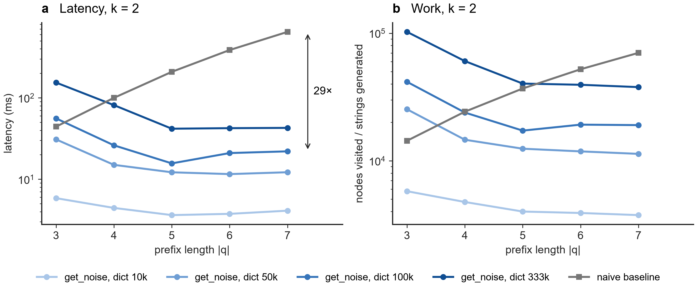

# Typo-tolerant autocomplete with a trie and a noisy channel



The pipeline on the query `moud` with at most one edit: (a) trie search, (b) noisy channel scoring, (c) ranking of the candidates with a softmax.

Given a mistyped prefix, the program finds the dictionary words whose beginning is within *k* edits of it, then ranks them by probability with a noisy channel model (Kernighan et al., 1990 [[1](#references)]).

## Try it

```
$ python src/demo.py
Enter a word : recieve
recieve : 24.21%
recieved : 23.31%
received : 17.08%
receive : 16.76%
reciever : 6.25%
```

## How it works

1. Trie search (`Trie.get_noise`, [src/trie.py](src/trie.py)). The dictionary is stored in a trie, which we walk depth first. Each node gets one row of a dynamic programming table: the edit distance between the node's prefix and each prefix of the query. The distance is OSA, i.e. Levenshtein plus swaps of two adjacent letters. Two rules decide what happens at a node:
   - if the last value of the row is at most *k*, the node's prefix is within *k* edits of the query, so its whole subtree is returned (up to 3 letters past the query length, `max_depth`);
   - if every value of the row is above *k*, no longer word can get back under *k*, so the branch is skipped.
2. Edit labelling (`Trie._label`). For each candidate, we find the edit that links the query to the start of the word (substitution, insertion, deletion or transposition) and the letters involved. Only one edit is labelled: with *k* = 2, a candidate two edits away is scored on its first edit only.
3. Noisy channel ranking ([src/noisy_channel.py](src/noisy_channel.py)). With *x* the query, each candidate *w* gets the score log P(*w*) + log P(*x* | *w*). The prior P(*w*) is the word's frequency in the dictionary. The likelihood P(*x* | *w*) comes from the four confusion matrices of Kernighan et al. [[1](#references)], with additive smoothing (δ = 0.5). A softmax turns the scores into probabilities that sum to 1 over the candidates. By Bayes' rule, this is P(*w* | *x*) restricted to the candidates, and it is what the demo prints.
4. Adaptation (`Trie.type`). Called with an accepted word, it adds 1 to the word's frequency and updates its last-used timestamp. Nothing calls it yet, the demo included: this part is implemented but neither wired in nor evaluated.

## Results

### Verification

`get_noise` returns exactly the same words as a brute-force search and as the naive baseline. The check covers 40 queries on 20,000 words, and 12 query and *k* combinations each on 100,000 and 333,333 words (`--scale-check`). Both `get_noise` and the brute force depend on one fact: the last row of the DP table gives the distance to every prefix. `benchmarks/bench.py` checks that fact separately against an independent OSA implementation.

### Against SymSpell

SymSpell (Garbe, 2012 [[2](#references)]) precomputes the deletions of every dictionary word. To make it complete words, our version ([src/symspell.py](src/symspell.py)) indexes the deletions of every dictionary prefix instead. It answers faster than the trie, but its index costs far more:

| 333,333 words, *k* = 2 | trie    | SymSpell                 | ratio                |
| ------------------------ | ------- | ------------------------ | -------------------- |
| memory                   | 0.18 GB | 5.07 GB (28.0 M entries) | 27×                 |
| build time               | 1.21 s  | 36.5 s                   | 30×                 |
| latency, \|q\| = 7       | 43.1 ms | 1.46 ms                  | SymSpell 29× faster |

Memory is what the structure allocates on top of the word list, measured with `tracemalloc`. Build time starts from the same word list and excludes reading the file. At *k* = 2, SymSpell is 2.6 to 54 times faster depending on dictionary size and prefix length, and it takes 21 to 27 times more memory. At 333,333 words, a word takes 84 entries in its index on average (61 at 10,000 words), against at most |*w*| nodes in the trie. Update cost should follow the same gap, but we have not timed it.



### Pruning

As the query gets longer, the naive baseline (generate every variant within distance *k*, Norvig style [[4](#references)]) enumerates more and more strings: 14,352 at |q| = 3, 70,184 at |q| = 7. `get_noise` visits 1.4 to 2.5 times fewer nodes at |q| = 5 than at |q| = 3, then stays roughly flat. These counters do not depend on the hardware. Panel (a) marks the latency gap at |q| = 7 on the 100k dictionary (29×); on 10k words it reaches 155×. Both factors are measured against this naive baseline, not against SymSpell.

Latencies are medians of 5 runs on 10 queries per cell, on an Intel x86-64 machine under Windows with Python 3.12; they change with the hardware, the counters do not.



### Recall

50,000-word dictionary, *k* = 2, 95 % Wilson intervals in brackets. Only pairs whose correct word is in the dictionary are kept; 60 pairs are drawn from each of Norvig's test sets and 300 from `spell-errors`. The query is the first |q| letters of the misspelling, so a row only counts the misspellings at least |q| letters long (*n* = 42 to 60, and 193 to 297). A pair counts as found if the correct word is among the candidates.

| \|q\|     | testset1 (dev)        | testset2              | spell-errors          |
| --------- | --------------------- | --------------------- | --------------------- |
| 3         | 21.7 % [13.1, 33.6]   | 15.0 % [8.1, 26.1]    | 26.6 % [21.9, 31.9]   |
| 5         | 78.2 % [65.6, 87.1]   | 43.1 % [31.2, 55.9]   | 41.8 % [36.0, 47.9]   |
| 7         | 83.3 % [69.4, 91.7]   | 69.2 % [55.7, 80.1]   | 54.4 % [47.4, 61.3]   |
| full word | 98.3 % [91.1, 99.7]   | 96.7 % [88.6, 99.1]   | 66.7 % [61.1, 71.8]   |

`spell-testset1` is Norvig's development set [[4](#references)]. It gives much higher recall than the two other sets (78 % against 43 % and 42 % at |q| = 5). The `spell-errors` numbers come from the largest sample and have the tightest intervals. Recall and precision are identical to the naive baseline's, since both methods compute the same function.

## Reproducing

```bash
pip install -r requirements.txt

python src/demo.py                  # interactive demo

# correctness (also at 100k and 333k words), recall on testset1, latency, SymSpell
python benchmarks/bench.py --scale-check
# recall on the two other test sets
python benchmarks/bench.py --skip test bench symspell --testset testset2
python benchmarks/bench.py --skip test bench symspell --testset errors --pairs 300
# memory and build time
python benchmarks/bench_memory.py
```

The `results/` folder is not under version control: these commands regenerate it.

To recompute the letter counts from the Brown corpus:

```bash
pip install -r train/requirements.txt
python -m nltk.downloader brown
python train/char_counts.py
```

## Layout

```
src/
  trie.py            trie, get_noise, _label, type
  noisy_channel.py   P(w) · P(x|w) score and softmax
  confusion.py       loads the confusion matrices
  baseline.py        naive baseline (variants within distance k)
  symspell.py        deletion index (Garbe, 2012)
  utils.py           OSA distance, softmax
  demo.py            command-line demo
benchmarks/
  bench.py           correctness, recall, latency, SymSpell
  bench_memory.py    memory and build time
train/
  char_counts.py     letter counts on the Brown corpus
  requirements.txt   extra dependency (nltk)
data/                dictionary, test sets, matrices
figures/             generated figures
```

## Data

The files in `data/dict` and `data/test` are unmodified copies of the originals.

| File | Source |
| --- | --- |
| `dict/en_freq.txt` | Peter Norvig's [count_1w.txt](https://norvig.com/ngrams/count_1w.txt): the 333,333 most frequent words of the Google Web Trillion Word Corpus, with their counts [[3](#references)] |
| `test/spell-testset1.txt` | Norvig's [spell-testset1.txt](https://norvig.com/spell-testset1.txt), the development set of *How to Write a Spelling Corrector* [[4](#references)], taken from Roger Mitton's Birkbeck corpus |
| `test/spell-testset2.txt` | Norvig's [spell-testset2.txt](https://norvig.com/spell-testset2.txt), the final test set of the same article, same corpus |
| `test/spell-errors.txt` | Norvig's [spell-errors.txt](https://norvig.com/ngrams/spell-errors.txt): 7,841 lines of misspellings from Wikipedia and Roger Mitton's corpus |
| `matrices/del.csv`, `insert.csv`, `sub.csv`, `rev.csv` | Copied from the tables of Kernighan, Church & Gale [[1](#references)] |
| `matrices/count_unigram.csv`, `count_bigram.csv` | Letter counts on the Brown corpus (NLTK), produced by `train/char_counts.py` |

## References

1. M. D. Kernighan, K. W. Church, W. A. Gale. [A Spelling Correction Program Based on a Noisy Channel Model](https://aclanthology.org/C90-2036/). COLING 1990, Vol. 2, pp. 205-210.
2. W. Garbe. [SymSpell](https://github.com/wolfgarbe/SymSpell), 2012.
3. P. Norvig. *Natural Language Corpus Data*. In *Beautiful Data*, O'Reilly, 2009. Data: [norvig.com/ngrams](https://norvig.com/ngrams/).
4. P. Norvig. [How to Write a Spelling Corrector](https://norvig.com/spell-correct.html).

## Authors

Younes Boufouss, Fares Shretah
